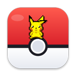
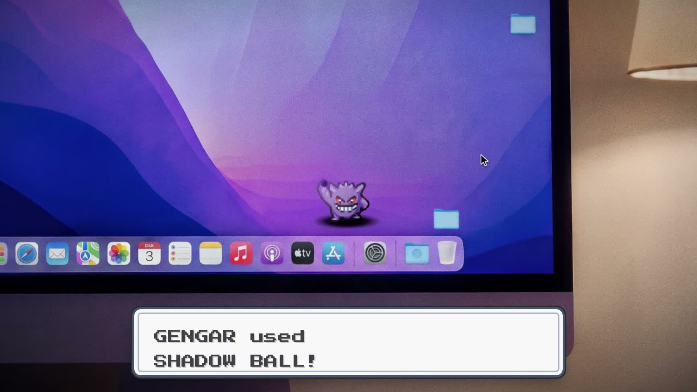
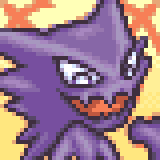
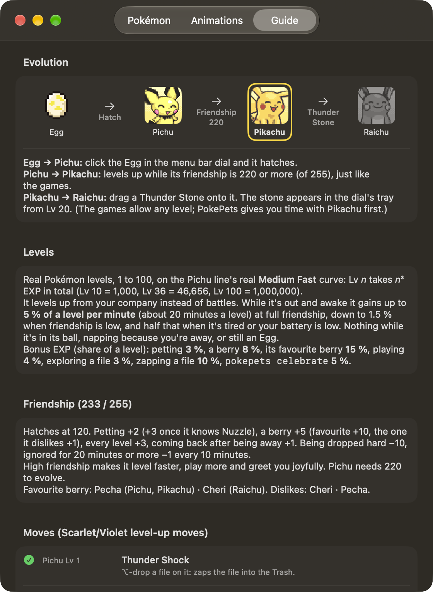
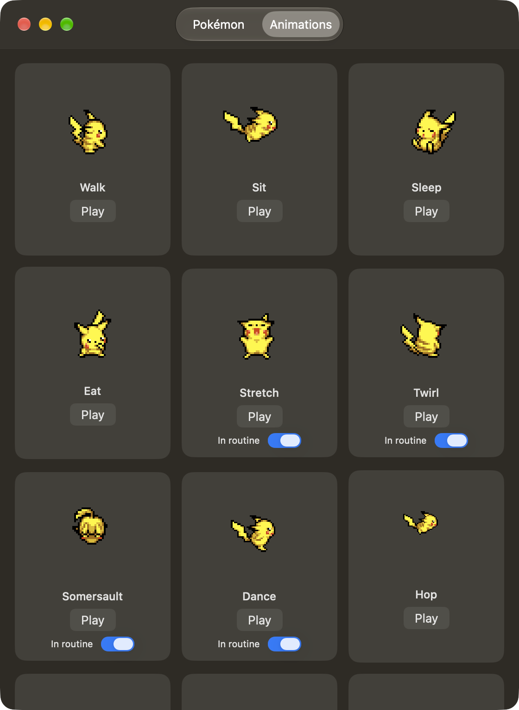

<div align="center">



# PokéPets

**Pokémon that live on your Mac desktop.**

They roam your screen, climb your files, get hungry, level up and evolve.
And when you ask, they clear out the junk for you.


<br>



<sub>Gengar on a real desktop (still from the teaser).</sub>

**Install:** paste `curl -fsSL https://raw.githubusercontent.com/YashTygi/PokePets/main/docs/install.sh | sh` into Terminal,
or [download the DMG](#download-the-dmg).

</div>

---

## What is it?

PokéPets is a native macOS menu bar app. Hatch an Egg from the Poké Ball in your menu bar and a
Pokémon walks out onto your desktop. It lives there with you:

- It **walks the floor and the Dock**, climbs the files on your desktop, and comes over when your cursor
  does.
- It has **feelings and needs**. It naps, gets hungry, plays, dances to your music and misses you when you
  leave.
- It **grows up for real**: real EXP curves, real level-up moves, friendship, natures, shiny odds, and an
  evolution you choose to accept.
- It **notices your Mac**: the charger, the battery, the heat, Wi-Fi, your camera, and a break you are
  overdue for.
- It **does useful things**: deletes files into the Trash with a Pikachu Thunderbolt or a Gengar Shadow
  Ball, and reacts when your build passes or fails.

Everything runs locally. There is no account, no analytics and no network requests.

## Meet the party

You raise one line at a time. Click a Poké Ball in the menu bar dial to send one out; the Pokémon already
out goes back into its ball first.

<table>
<tr>
<td colspan="7" align="center"><b>⚡ The Pichu line</b> · Electric · abilities Lightning Rod and Surge Surfer</td>
</tr>
<tr>
<td align="center"><br><b>Pichu</b></td>
<td align="center">→</td>
<td align="center"><br><b>Pikachu</b></td>
<td align="center">→</td>
<td align="center"><br><b>Raichu</b></td>
<td align="center">or</td>
<td align="center"><br><b>Alolan Raichu</b></td>
</tr>
</table>

<table>
<tr>
<td colspan="5" align="center"><b>👻 The Gastly line</b> · Ghost / Poison · ability Levitate</td>
</tr>
<tr>
<td align="center"><br><b>Gastly</b></td>
<td align="center">→</td>
<td align="center"><br><b>Haunter</b></td>
<td align="center">→</td>
<td align="center"><br><b>Gengar</b></td>
</tr>
</table>

| Step | How it happens |
|---|---|
| Egg → Pichu / Gastly | Click the Egg in the menu bar dial. It falls, cracks and hatches. |
| Pichu → Pikachu | Level up with friendship of 220 or more (out of 255), as in the games. |
| Pikachu → Raichu | Give it a **Thunder Stone** from the dial's tray (available from Lv 20). Your **Region** setting picks Raichu (Kanto) or Alolan Raichu (Alola). |
| Gastly → Haunter | Reaches Lv 25 and asks to evolve. |
| Haunter → Gengar | Give it a **Linking Cord** from the tray, as in *Legends: Arceus*. |

Evolution is always your call: a notification offers **Evolve** or **Not Now**, and it asks again at the
next level if you wait. Every hatch rolls a gender, one of 25 natures, an ability, and a 1 in 4096 chance
of being shiny. There is even a rare Pokérus.

> **Coming next:** Typhlosion, Pidgeot, Alakazam and Lapras already have slots on the party screen.

## A tour of what they do

### Roaming your desktop

- Walks the bottom of the screen and hops onto the **Dock**, crossing it and jumping off.
- **Climbs your desktop files**, sniffs newly appeared ones, and sits on top.
- Stays **behind full-screen windows, videos and YouTube**, and behind any apps you list. With
  *Walks over your apps* on, it strolls over your windows too.
- The overlay is click-through. Your desktop and apps keep working normally; it only catches the mouse when
  your cursor is over a Pokémon.
- Pick it up, swing it about (it gets dizzy), put it down gently or drop it from a height and watch it
  land. Drop it too often and it cries.

### Having feelings

- **Looks up at your cursor**, gets curious (`?`) or startled (`!`), settles in beside you, and shows hearts
  when you hover over it. Shy natures keep their distance until they trust you.
- Shows **emotion portraits** and speaks in its own voice. Pikachu is sparky and cheerful. Gengar
  teases, threatens to lick your screen if you do not feed it, and jokes about having hidden your stuff.
- **Gets hungry about every half hour.** Drag a berry from the dial onto it. Each Pokémon has a favourite
  and a berry it dislikes.
- **Naps** when it is tired, curls up when you step away for five minutes, and wakes up glad when you are back.
- Greets you with a good morning, afternoon or evening the first time it sees you each day.

### Growing up

- Real **Lv 1 to 100**: Medium Fast for the Pichu line and Medium Slow for the Gastly line.
- Levels come from your company, not battles: it earns EXP while it is out and awake, plus bonuses for
  petting, berries, playing, exploring a file or zapping one.
- **Friendship (0–255)** speeds up growth and makes it more playful. Neglect and rough handling lower it.
- **Real learnsets** from *Scarlet/Violet*. New moves unlock new behaviour: Quick Attack makes Pikachu leap,
  Sweet Kiss and Nuzzle give more affection, Charm adds a dance, Double Team a twirl, Agility a somersault,
  and Gengar's Shadow Ball upgrades its delete move.
- The **Guide** tab in Settings shows the evolution path, the maths and every move.

### Noticing your Mac

| It notices | It reacts |
|---|---|
| Charger plugged in | Celebrates, and its ability kicks in (the Pichu line sparks up; Alolan Raichu surfs fast laps) |
| Battery 20% or below | Gets tired and slow |
| Battery 5% or below | Faints until you plug in |
| Mac running hot | Sweats and slows down; faints if it overheats |
| Wi-Fi drops or returns | Looks worried, then cheers up |
| Camera turns on | Goes back into its Poké Ball for your call, then comes back out |
| Apple Music or Spotify playing | Dances now and then |
| You step away for 5 minutes | Curls up asleep |
| A long stretch of non-stop use | Stretches and suggests a break (off by default) |
| Evening and night, or dark mode | Gengar's *ghost hour*: a purple glow and extra mischief |
| Focus mode (via a Shortcuts automation) | Sleeps and ignores everything until it ends |

### Tidying your files

Nothing is ever erased. Every delete goes to the **Trash**, where you can get it back.

- Select files in Finder and press **⌥⌘⌫**. Whoever is out zaps them: Pikachu's Thunderbolt strikes the
  file's icon, Gengar throws a Shadow Ball. Finder's own ⌥⌘⌫ is "Delete Immediately", so while the feature
  is on, PokéPets takes over only that shortcut, and only while Finder is in front.
- Or **⌥-drag a file onto the Pokémon**.
- The **Downloads guard** spots files you probably do not need any more: downloads over 500 MB, duplicate
  copies, and installers you have finished with. It offers **Delete** or **Keep** right in the
  notification, once per file.

### Gengar is a menace

Thanks to Levitate, Gengar is not tied to the floor. It flies anywhere on your screen, and its tricks
get more annoying as it evolves:

- **Phases into your front window**, sinks into its edge and peeks out of the sides.
- **Licks your screen** and leaves saliva that drips and fades.
- **Pops its head out near your cursor:** "Boo!"
- **Steals your cursor** (full Gengar only). It flies off with a fake one; move the mouse to get yours back.
- **Makes shadow clones** ("Which one's the real me?") and chases its own shadow.
- **Pranks:** tickles the Dock, tugs at a window, or leaves handprints.

### Hooks for developers

Let your Pokémon react to your terminal, git hooks, CI scripts or AI agents:

```bash
make && bin/pokepets celebrate || bin/pokepets fail
```

| Command | What happens |
|---|---|
| `pokepets celebrate` | Build passed or tests are green: joyous, Thunder Shock or a happy pose |
| `pokepets fail` | Build failed: it faints for a few seconds |
| `pokepets done` | A long job or an agent finished: joyous, hearts |
| `pokepets hello` | Just says hi |
| `pokepets focus` / `unfocus` | Goes quiet and sleeps / wakes up |

`bin/pokepets` is a one-line wrapper around a URL scheme (put `bin/` on your `PATH` to call it as plain
`pokepets`). Anything that can open a URL works: `open -g pokepets://celebrate`, an Automator action, or a
Shortcuts "Open URL" step.

## Settings

Open them from the menu bar Poké Ball (right-click, then **Settings**). There is a party screen, a General
page with a switch for every behaviour, and a page per Pokémon.

<table>
<tr>
<td align="center" width="50%"></td>
<td align="center" width="50%"></td>
</tr>
<tr>
<td align="center"><sub><b>Guide:</b> evolution path, EXP curve, friendship rules, moves</sub></td>
<td align="center"><sub><b>Animations:</b> every animation, playable, with <i>In routine</i> switches</sub></td>
</tr>
</table>

There is also a **Why?** tab that shows what the Pokémon is thinking: its needs and the live score of every
option it is considering.

## Install

**Requirements:** macOS 14 (Sonoma) or later. Apple silicon and Intel Macs both work.

### One command (recommended)

Paste this into Terminal:

```bash
curl -fsSL https://raw.githubusercontent.com/YashTygi/PokePets/main/docs/install.sh | sh
```

It downloads [`PokePets.dmg`](docs/downloads/PokePets.dmg) and its checksum from this repository,
**stops if the SHA-256 doesn't match**, copies `PokePets.app` into `/Applications` (or `~/Applications` if
that isn't writable), and opens it. It never uses `sudo`, and it leaves your shell and login items alone.
An older copy is replaced and your Pokémon are kept. [Read the script first](docs/install.sh); it is about 80 lines.

There is no "can't verify" warning this way. PokéPets is free, so Apple hasn't notarized it, and macOS
stops anything a *browser* downloads that isn't notarized. A file fetched with `curl` never gets that mark,
and the script clears it from the installed copy as well. The checksum is the check that remains.

To remove it again (your Pokémon are kept; add `--purge` to remove them too):

```bash
curl -fsSL https://raw.githubusercontent.com/YashTygi/PokePets/main/docs/uninstall.sh | sh
```

### Download the DMG

Grab [`PokePets.dmg`](docs/downloads/PokePets.dmg) (about 7 MB, with its [SHA-256](docs/downloads/PokePets.dmg.sha256)).
Because a browser marked it as downloaded from the internet, **macOS will stop it once**. This is what to do:

1. Open `PokePets.dmg`. macOS says **“PokePets.dmg” Not Opened: Apple could not verify it is free of malware**.
   Click **Done**, *not* Move to Bin (it says Move to Trash on a US-English Mac).
2. Open **Apple menu → System Settings → Privacy & Security**. Scroll down to **Security**, find
   *“PokePets.dmg” was blocked to protect your Mac*, and click **Open Anyway**. Enter your Mac password or use Touch ID.
3. macOS asks one last time. Click **Open** (or **Open Anyway**). Never Move to Bin.
4. Drag **PokePets** into Applications and open it. If macOS stops the app itself the same way, repeat
   steps 2 and 3 once. After that it opens normally.

Prefer Terminal? `xattr -dr com.apple.quarantine /Applications/PokePets.app` clears the mark on the app.

### Build from source

You need Xcode 16 or later.

```bash
git clone https://github.com/YashTygi/PokePets.git
cd PokePets
open PokePets.xcodeproj
```

In Xcode, select the **PokePets** target, open **Signing & Capabilities**, choose your own **Team**, and
press **⌘R**. The build lands in `~/Applications/PokePets.app` and launches.

Prefer the command line?

```bash
xcodebuild -project PokePets.xcodeproj -scheme PokePets -configuration Debug build -quiet \
  DEVELOPMENT_TEAM=YOUR_TEAM_ID
open ~/Applications/PokePets.app
```

> **Why `~/Applications`, and why sign with a team?**
> macOS only offers the notification prompt to apps that live in an Applications folder, so the project
> builds straight there. And a real signing identity (a free personal team is fine) keeps your Accessibility
> and Automation grants across rebuilds; ad-hoc signing makes macOS forget them every time. (The DMG is
> ad-hoc signed, so after an update you grant them once more.)

### Making a release

`bin/make-dmg.sh` builds a universal Release app, packs it into `docs/downloads/PokePets.dmg` and writes
`PokePets.dmg.sha256` next to it. The installer downloads exactly those two files, so commit them together.
It builds in a temporary folder, so it never touches the copy in your `~/Applications`.

### First launch

A short welcome guide walks through the house rules (where Pokémon may go, deleting files, feelings, what
they notice on your Mac) and asks for permissions one at a time. Every permission is optional:

| Permission | What it is for | If you say no |
|---|---|---|
| Notifications | Level-ups, hunger, evolution prompts, Downloads guard | They stay quiet; captions still show |
| Automation → Finder | Finds your desktop files so they can climb them | No file climbing |
| Automation → your browser | Notices a YouTube video so they stay out of the way | They will not hide for YouTube in that browser |
| Accessibility | Aims the Thunderbolt at the file's exact icon in Finder | Files still go to the Trash, just aimed less precisely |
| Files & Folders → Downloads | Downloads guard | Guard stays off |

Then click the Poké Ball in the menu bar, click the Egg, and say hello.

### Using it

| Do this | To get this |
|---|---|
| Click the menu bar Poké Ball | Open the party dial: send out or recall, check stats, grab berries and evolution items |
| Right-click the Poké Ball | Settings and Quit |
| Drag a berry onto your Pokémon | Feed it |
| Hover your cursor over it | Pet it |
| Drag it, swing it, let go | Pick it up, make it dizzy, drop it |
| Select files in Finder, press ⌥⌘⌫ | It deletes them into the Trash |
| ⌥-drag a file onto it | Same thing |
| Drag a Thunder Stone or Linking Cord onto it | Evolve it, once it is ready |

## Try every feature

`bin/try` relaunches PokéPets running one demo, so you do not have to wait for a Pokémon to decide to do it.
The Pokémon must have hatched first.

```bash
bin/try <demo> <who>      # <who> is "pet" (Pichu line) or "gengar" (Gastly line)
bin/try dock pet          # walk to the Dock, jump on, cross it, jump off
bin/try fly gengar        # Gengar flies about
pkill -x PokePets; open ~/Applications/PokePets.app    # back to normal
```

| Demo | For | What you see |
|---|---|---|
| `dock` · `files` · `drop` | everyone | Walks the Dock · climbs your desktop files · gets dropped every 5 s |
| `feed` · `eat` | everyone | Gets hungry and eats a berry · comes to ask you for one |
| `levelup` · `play` · `break` | everyone | Level-up caption and notification · playful moves on repeat · break reminder |
| `stone` · `evolve` · `float` | `pet` | Thunder Stone evolve menu · Pichu offers to evolve · Alolan Raichu floats |
| `fly` · `phase` · `boo` · `lick` | `gengar` | Free flight · sinks into your front window · "Boo!" at your cursor · licks your screen |
| `snatch` · `shadowball` · `clone` · `shadow` · `prank` | `gengar` | Steals the cursor · Shadow Ball · shadow clones · its shadow runs off · a random prank |
| `evolve` · `cord` | `gengar` | Gastly offers to evolve · Haunter gets the Linking Cord |

Useful flags go after the demo, for example `bin/try - gengar -PokeGhostHour YES`. Open a screen directly with
`-PokeSettings party|general|credits|pet|gengar`, or replay the welcome guide with `-onboarded NO`.

## How it works

PokéPets is about 8,000 lines of Swift in 19 files, built on AppKit and Core Animation (SwiftUI for the
Settings and welcome windows). It has **no third-party dependencies**, and it is built to stay almost
invisible in Activity Monitor.

- **No per-frame loop.** One transparent, click-through window covers the screen, and each Pokémon is a
  single `CALayer`. The walk cycle is a `CAKeyframeAnimation` over the sprite sheet's `contentsRect`, and
  movement is a Core Animation move, so macOS's render server plays it while the app sleeps. The app only
  wakes to make a decision.
- **A utility-AI brain.** Every action (nap, patrol, play, ask for a berry, fly, prank…) is scored from
  0 to 1 against energy, hunger, friendship, boredom, time of day, battery, music and the Pokémon's nature.
  It picks among the options within 15% of the best, so it feels alive without being random.
  The **Why?** tab shows those scores live.
- **Event-driven senses.** Battery and charger (`IOPS` notifications), Wi-Fi (`NWPathMonitor`), heat
  (thermal-state notifications), `~/Downloads` (a file-system watch), and mounted disk images (workspace
  notifications) all wake the app only when something changes. Two cheap checks do run on timers: an idle
  check every 20 s (every 2 s while you are away), and, while *Walks over your apps* is on, a look every
  2 s at whether the app in front is full screen, so the Pokémon can slip behind a video.
- **One engine, many species.** `Companion` holds everything shared (needs, growth, the brain, feeding,
  petting, hooks). A species is a small subclass that adds its sprites, moves, ability and evolution rules.
  Adding a Pokémon means adding a subclass and a sprite sheet.
- **Sprites** come from PMD SpriteCollab. Each animation is a sheet with a row per direction, described by
  an `AnimData` XML, and `bin/import-sprites.swift` imports a Pokémon, its shiny and its portraits (and
  adds the artists to `credits.json`). Pixels are drawn with nearest-neighbour filtering so they stay crisp.
- **Private by design.** No network requests, no analytics. The Pokémon data (learnsets, growth rates,
  natures, Pokédex text) is baked in, and your party's save lives in `UserDefaults`.

### Project layout

```
PokePets/
├── PokePets.xcodeproj
├── PokePets/                 # the app
│   ├── PokePetsApp.swift       # app entry point
│   ├── AppDelegate.swift       # wires the party, the dial, the senses and the hooks together
│   ├── Companion.swift         # the shared engine every Pokémon subclasses
│   ├── Pikachu.swift           # Pichu line: Thunderbolt, Lightning Rod, Thunder Stone
│   ├── Gengar.swift            # Gastly line: flight, phasing, pranks, Linking Cord
│   ├── Brain.swift             # utility-AI intents and scoring
│   ├── Growth.swift            # EXP curves, natures, learnsets, evolution rules
│   ├── Pet.swift               # one Pokémon's CALayer and its animations
│   ├── StageWindow.swift       # the transparent overlay and the floor, Dock and file icons
│   ├── PartyDial.swift         # menu bar Poké Ball and the party dial
│   ├── Pokeball.swift          # the Poké Ball throw and recall effects
│   ├── Effects.swift           # pixel-art hearts, sparks, berries and items
│   ├── Senses.swift            # away, camera, heat, Wi-Fi, music
│   ├── Power.swift             # battery and charger
│   ├── ThunderboltKey.swift    # ⌥⌘⌫ in Finder
│   ├── DownloadsGuard.swift    # big files, duplicates, finished installers
│   ├── Settings.swift          # Settings window (SwiftUI)
│   ├── Onboarding.swift        # first-launch welcome guide
│   ├── Chatter.swift           # what they say
│   ├── *-anim.xml, *.png       # SpriteCollab sheets, portraits and animation maps
│   └── credits.json            # sprite artists, shown in Settings › Credits
├── bin/
│   ├── make-dmg.sh             # build the Release app into docs/downloads/PokePets.dmg
│   ├── build-site-sprites.py   # regenerate the website's sprite data
│   ├── try                     # relaunch with a demo
│   ├── pokepets                # make your Pokémon react from a script
│   ├── import-sprites.swift    # import a Pokémon and its shiny from SpriteCollab
│   └── make-icon.swift         # draws the app icon
├── docs/                       # the website, plus the installer and the download
│   ├── index.html, assets/       # the site (static; GitHub Pages can serve it from /docs)
│   ├── install.sh, uninstall.sh  # the one-line installer and its undo
│   └── downloads/                # PokePets.dmg and PokePets.dmg.sha256
└── CREDITS.md
```

## Roadmap

- **Typhlosion** (Fire), **Pidgeot** (Flying), **Alakazam** (Psychic) and **Lapras** (Water) to fill the
  rest of the six-slot party, each with its own roaming style and utility move.
- Riding along as a window is dragged (Accessibility notifications, no polling).
- Importing a Pokémon Showdown team.

## Credits and legal

All Pokémon sprites and portraits come from **[PMD SpriteCollab](https://sprites.pmdcollab.org)**. Thank you
to every artist who drew them; each one is named in [CREDITS.md](CREDITS.md) and in Settings › Credits.
Pokémon data (learnsets, growth rates, natures, Pokédex text) comes from [PokéAPI](https://pokeapi.co).
The Egg, berries, Thunder Stone, Linking Cord, Poké Ball, hearts and sparks are pixel art made for PokéPets.

Pokémon and Pokémon character names are © Nintendo, Creatures Inc. and GAME FREAK inc. **PokéPets is an
unofficial, non-commercial fan project. It is not affiliated with or endorsed by them, and it is not for
sale.** Some of the sprites are licensed CC BY-NC 4.0, so keep it that way if you fork it.
